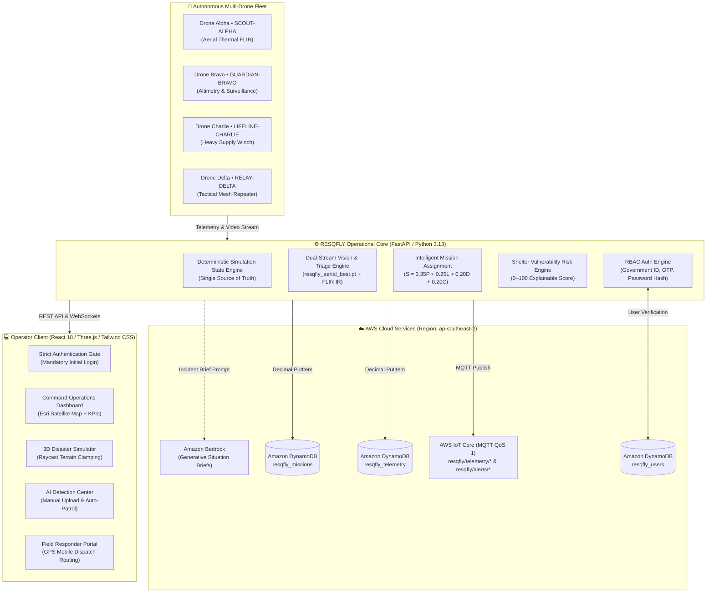

# 🚁 RESQFLY — Intelligent Multi-Drone Disaster Rescue & Relief System

[-232F3E?style=flat&logo=amazon-aws&logoColor=FF9900)](https://aws.amazon.com/)
[](https://aws.amazon.com/dynamodb/)
[](https://aws.amazon.com/iot-core/)
[](https://fastapi.tiangolo.com/)
[](https://threejs.org/)
[](https://ultralytics.com/)
[-10B981?style=flat&logo=pytest&logoColor=white)](#-automated-testing--verification)

> **Tagline:** *"Every Location Matters. Every Life Matters."*  
> **Operational Scenario:** Severe coastal storm surge and catastrophic inundation during an extreme weather event in North Haven coastal village.  
> **Official Repository:** [https://github.com/HaribhaskaranA/resqfly](https://github.com/HaribhaskaranA/resqfly)

---

## 📖 Table of Contents
1. [Executive Summary & Problem Statement](#-executive-summary--problem-statement)
2. [End-to-End System Architecture](#-end-to-end-system-architecture)
3. [Algorithmic & AI Decision Engines](#-algorithmic--ai-decision-engines)
4. [Autonomous Multi-Drone Fleet & Tactical Rescue Units](#-autonomous-multi-drone-fleet--tactical-rescue-units)
5. [AWS Cloud Integration Architecture](#-aws-cloud-integration-architecture)
6. [Authentication, RBAC & User Management](#-authentication-rbac--user-management)
7. [The 9 Command Center Screens & Tactical Field Portal](#-the-9-command-center-screens--tactical-field-portal)
8. [AI Detection Center: Manual vs. Autonomous Guidance](#-ai-detection-center-manual-vs-autonomous-guidance)
9. [Pre-Deployment Security & Safety Checklist](#-pre-deployment-security--safety-checklist)
10. [Quick Start & Installation Guide](#-quick-start--installation-guide)
11. [Automated Testing & Verification](#-automated-testing--verification)
12. [Repository Directory Structure](#-repository-directory-structure)

---

## 🎯 Executive Summary & Problem Statement

During catastrophic coastal flooding, rising sea levels and storm surges submerge roadway infrastructure within minutes. First responders face critical communication blackouts, incomplete aerial reconnaissance, and the risk of dispatching heavy rescue watercraft into unnavigable shallows or sending life-saving supplies to incorrect locations.

**RESQFLY** solves this disaster response challenge by integrating:
- **Autonomous Multi-Drone Swarm Coordination**: Four specialized virtual drones performing synchronized search-and-recon, physical water altimetry, heavy relief cargo drops, and high-altitude tactical mesh communications.
- **Dual-Stream Sensor Fusion (RGB + Thermal FLIR)**: An edge-deployable YOLO aerial detection model (`resqfly_aerial_best.pt`) coupled with physical landmark-based water depth estimation.
- **Transparent Multi-Criteria Algorithmic Engines**: Mathematical mission assignment, explainable shelter risk scoring, and automated emergency routing without opaque black boxes.
- **Dual 3D / High-Resolution Satellite Visualizations**: Interactive Three.js disaster canvas with mathematical raycast elevation grounding alongside real-time Esri World Imagery satellite maps.
- **Production AWS Cloud Backbone**: Low-latency telemetry streaming over AWS IoT Core MQTT, resilient state persistence across three Amazon DynamoDB tables, and Amazon Bedrock incident briefing in region **`ap-southeast-2` (Sydney)**.

---

## 🏗️ End-to-End System Architecture



---

## 🧠 Algorithmic & AI Decision Engines

### 1. Intelligent Multi-Criteria Mission Assignment Engine
Rather than simple proximity dispatch, RESQFLY evaluates a mathematically transparent multi-factor suitability formula:

$$\mathbf{S = 0.35P + 0.25L + 0.20D + 0.20C}$$

- **$P$ (Battery Suitability)**: Evaluates whether the drone has sufficient energy to reach the target, hover/deliver, and return to base while maintaining a **mandatory $\ge 20\%$ reserve threshold**. Drones violating this are hard-rejected.
- **$L$ (Payload Capacity Suitability)**: Ratio of drone payload capacity to required humanitarian cargo weight (water, food, medical kits). If cargo exceeds max payload, the drone is rejected.
- **$D$ (Proximity Distance Suitability)**: Euclidean distance penalty favoriting closer assets to minimize response time.
- **$C$ (Capability Specialty Match)**: Bonus multiplier when assigned mission role matches drone hardware specialty (e.g., Lifeline for supply drops, Scout for reconnaissance).

### 2. Transparent Shelter Vulnerability Risk Engine
Every shelter is continuously evaluated and assigned an explainable advisory vulnerability score from **0 to 100**:

$$\text{Risk} = \text{Elevation Deficit} + \text{Surge Trend} + \text{Road Isolation Penalty} + \text{Overcrowding} + \text{Supply Deficit} + \text{Structural Damage}$$

- **Low Risk (0–29)**: Fortress shelters on elevated bluffs (e.g., Harborview Hospital at 6.2m elevation).
- **Moderate Risk (30–59)**: Shelters on intermediate terrain with adequate food/water reserves.
- **High Risk (60–79)**: Shelters with cut-off roads or approaching floodwater levels.
- **Critical Risk (80–100)**: Immediate submersion breach hazard requiring coordinated evacuation diversion (e.g., North Haven Community School at 2.2m elevation when surge reaches 2.45m+).

### 3. Dual-Stream Multi-Modal AI Triage (YOLOv8 + Thermal FLIR)
- **Computer Vision Model**: `resqfly_aerial_best.pt` (5.4 MB YOLO aerial weights) trained on high-altitude top-down perspective human silhouettes.
- **Thermal Heat-Contrast Verification**: Validates human body heat signatures (+3°C to +8°C above cold floodwater) to prevent false positives from debris or floating wreckage.
- **Physical Landmark Depth Estimation**: Automatically detects submerged light poles (3.0m baseline) and building ground floors (3.5m baseline) to accurately calculate water depth in meters.
- **Autonomous Dispatch Rules**:
  - $\text{Depth} \ge 1.8\text{m} \implies \text{DISPATCH\_RESCUE\_BOAT}$ (Alpha Watercraft Squad).
  - $\text{Victims Trapped on High Ground} \implies \text{DISPATCH\_LIFELINE\_DRONE}$ (Emergency rations and medical drop).

### 4. 3D Terrain Raycast Elevation Clamping (`getTerrainHeight(x, z)`)
To eliminate floating or sunken 3D structures, a mathematical elevation surface maps the coastal geography:
- **Lighthouse Promontory (NW)**: Peak elevation 14.0m.
- **East Ridge High Ground (NE/E)**: Elevation 9.5m.
- **Harborview Hospital Citadel**: Elevation 6.0m.
- **Coastal Base Outpost**: Elevation 10.0m.
- **Canal Tidal Basin**: Inundation trough 1.8m to 2.2m.
All 40 buildings, foliage trees, stranded victim humanoid clusters, and arachnid ground crawlers are clamped directly to `y = getTerrainHeight(x, z)`. The reflective floodwater plane at `+2.45m` cleanly intersects building ground floors without clipping structures into the void.

---

## 🛸 Autonomous Multi-Drone Fleet & Tactical Rescue Units

### Drone Fleet Specifications

| Callsign | Model | Role | Hardware Equipment | Max Payload | Cruise Speed |
| :--- | :--- | :--- | :--- | :--- | :--- |
| **Drone Alpha** | `DRONE-01` | Thermal Recon & Search Scanner | Optical 4K Zoom + FLIR Lepton 3.5 IR | 3.0 kg | 16.0 m/s |
| **Drone Bravo** | `DRONE-02` | Flood Surveillance & Altimetry | Laser LiDAR Altimeter + Multispectral | 4.0 kg | 14.0 m/s |
| **Drone Charlie** | `DRONE-03` | Emergency Supply & Relief Cargo | Heavy-Lift Winch + Supply Release Pod | 15.0 kg | 12.0 m/s |
| **Drone Delta** | `DRONE-04` | Tactical Mesh & Route Relay | High-Altitude RF Repeater + SATCOM Link | 2.0 kg | 18.0 m/s |

### Standardized Tactical Rescue Units

- **`RESCUE UNIT-01 [ALPHA WATERCRAFT SQUAD] • Rapid Inundation Response`**  
  *Team Leader:* Capt. Liam Vance (`TIDE-LEAD`) • *Asset:* Twin-Engine Inflatable Flood Craft • *Target:* Sector 1: Coastal Canal Bridge (`41.3850° N, -70.5280° W`)
- **`RESCUE UNIT-02 [BRAVO AMPHIBIOUS TEAM] • Shallow Water Evacuation`**  
  *Team Leader:* Lt. Marcus Hayes (`AMPHI-ONE`) • *Asset:* 6x6 Tracked Amphibious Vehicle • *Target:* Sector 2: Low-Lying Marsh & School Access (`41.3835° N, -70.5295° W`)
- **`AIR-SUPPORT [LIFELINE-CHARLIE] • Drone Airdrop Cargo Unit`**  
  *Pilot:* Flight Officer Sarah Chen (`AIR-DROP-CHG`) • *Asset:* Autonomous Heavy-Lift Cargo Drone • *Target:* Sector 3: Isolated Rooftops & Pier #14 (`41.3862° N, -70.5270° W`)

---

## ☁️ AWS Cloud Integration Architecture

The platform operates in **region `ap-southeast-2` (Sydney)** under IAM identity `iithack` (`arn:aws:iam::312469489912:user/iithack`).

```
                    ┌─────────────────────────────────────────┐
                    │       AWS Cloud (ap-southeast-2)        │
                    ├────────────────────┬────────────────────┤
                    │   AWS IoT Core     │  Amazon DynamoDB   │
                    │   MQTT Topics      │  Active Tables     │
                    ├────────────────────┼────────────────────┤
                    │ resqfly/telemetry  │ resqfly_telemetry  │
                    │ resqfly/alerts     │ resqfly_missions   │
                    │ QoS 1 TLS Session  │ resqfly_users      │
                    └────────────────────┴────────────────────┘
```

1. **Amazon DynamoDB Persistence**:
   - `resqfly_telemetry`: Stores drone positions, batteries, altitudes, and speeds. Float types are automatically serialized to `Decimal` objects.
   - `resqfly_missions`: Stores mission records, sectors, target GPS coordinates, action codes, and victim counts.
   - `resqfly_users`: Stores user credentials with partition key `government_id` (String), password hashes, roles, and verification status.
2. **AWS IoT Core MQTT Streaming**:
   - Publishes live telemetry every 5 seconds to `resqfly/telemetry/scout-alpha`, `resqfly/telemetry/lifeline-charlie`, and individual drone topics.
   - Emergency dispatch triggers publish instant incident payloads to `resqfly/alerts/emergency`.
3. **Cloud Health API Endpoint**:
   - `GET /api/aws/status`: Exposes real-time connectivity status, table names, published message counts, and ATS IoT endpoint address.

---

## 🔐 Authentication, RBAC & User Management

### Strict Auth Gate
When accessing `/` or `http://localhost:8000`, unauthenticated visitors are strictly redirected to the **Login / Register Page**. Internal platform screens cannot be accessed without valid session tokens.

### Pre-Configured Verified Personnel Accounts
The following verified personnel accounts are pre-seeded in the AWS DynamoDB `resqfly_users` table:

| Government ID | Role | Password | Assigned View | Permissions |
| :--- | :--- | :--- | :--- | :--- |
| **`GOV-DM-001`** | **COORDINATOR** (`command_center`) | `Demo@1234` | Full Command Operations Center | Fleet dispatch, shelter relocation approval, AI patrol, analytics |
| **`FR-001`** | **RESCUE_TEAM** (`field_rescue`) | `Field@1234` | Tactical Field Rescue Portal | Accept mission dispatches, view GPS target maps, confirm evacuations |

---

## 🖥️ The 9 Command Center Screens & Tactical Field Portal

### Coordinator Views (Full Command Center Layout)
1. **Command Operations Dashboard**: Real-time disaster KPIs, high-resolution Esri World Imagery satellite map with spider victim markers (`🕷️`), 4 active drone flight trails, and live alert ticker.
2. **Tactical Terrain Map**: Satellite map with muddy brown turbid floodwater polygons, water height indicators, shelter locations, and click-to-center controls.
3. **3D Flood Simulator**: Full-screen interactive Three.js coastal environment with dynamic water elevation slider (`0.0m – 6.0m`), raycast-clamped buildings, rooftop cobwebs, and Day/Night storm lighting toggle.
4. **Drone Fleet Management**: Live battery gauges, speed, altitude, payload monitors, and raw AWS IoT Core MQTT packet streams.
5. **Human Detection AI**: Dual-stream RGB + FLIR thermal viewports, YOLO inference, physical landmark depth altimetry, and human-in-the-loop dispatch controls.
6. **Shelter Safety Center**: Vulnerability list with 0–100 risk meters, six-factor breakdown, and supply runway hours.
7. **Relief & Inventory**: Emergency SOS request queue, supply inventory monitors (water canisters, high-calorie ration packs, trauma kits, satellite beacons), and automated drone mission dispatch.
8. **Rescue Coordination**: High-ground designated shelter evacuation plans (diverting 130 occupants from North Haven School to Regional Hospital) and tactical boat unit deployment.
9. **Analytics & History**: Fleet battery curves, flood surge escalation charts, and AWS CloudWatch event audits.

### Field Responder View (Tactical Field Portal)
- Dedicated mobile-optimized interface showing incoming dispatch orders in real time.
- Direct Google Maps GPS navigation links for target coordinates.
- 1-click **"Accept Dispatch & En Route"** and **"Confirm Casualty Evacuation"** triggers.

---

## 🤖 AI Detection Center: Manual vs. Autonomous Guidance

The Human Detection AI page features an interactive, expandable **Operational Guidance Manual**:

### 1. Manual AI Mode
- **Custom Upload**: Upload your own optical drone photos (`Upload RGB`) or thermal IR camera captures (`Upload FLIR`).
- **Inference**: Click `Run Triage` or select pre-calibrated scenarios (`Critical (3.8m Flood)`, `Safe Ridge (0.6m Flood)`, or `Clear (0m Depth)`).
- **Coordinator Review**: When set to **Manual Approval**, dispatch recommendations remain pending until the human incident coordinator clicks **Authorize & Deploy Mission**.

### 2. Switching to Autonomous Mode
- **Step 1**: Toggle the **`AUTONOMOUS PATROL FEED`** switch to **`ON`** (green pulsing radar icon).
- **Step 2**: Set the Execution Mode toggle to **`AUTONOMOUS (AUTO-DISPATCH)`**.
- **Auto-Dispatch**: Drone Alpha autonomously scans sectors every 3.0 seconds, computes physical water depths, and dispatches rescue craft to DynamoDB without requiring manual intervention.

### 3. Demo Data Calibration Notice
> **DEMO CALIBRATION NOTICE**: Autonomous Patrol Mode currently operates on **realistic calibrated demo scenario feeds** (simulating North Haven coastal bridge, rooftop stranded party, submerged school access, and open waters). This guarantees uninterrupted, reproducible demonstration without requiring live hardware drone camera links in flight.

---

## 🛡️ Pre-Deployment Security & Safety Checklist

- [x] **Zero Secrets in Repository**: `.env`, `backend/.env`, `*.pem`, `*.key`, `*.token`, `*.crt`, and AWS access key files are strictly excluded via `.gitignore`.
- [x] **Cache & Artifact Exclusion**: `node_modules/`, `dist/`, `build/`, `__pycache__/`, `*.pyc`, and `.venv/` are strictly ignored.
- [x] **YOLO Weight Management**: `resqfly_aerial_best.pt` (5.4 MB) is tracked safely well below GitHub's 50MB/100MB thresholds.
- [x] **Strict Landing Auth Gate**: First-time or unauthenticated visits strictly render the Login / Register screen.
- [x] **Verified AWS Credentials**: Uses official AWS SDK (`boto3`) scoped strictly to region `ap-southeast-2`.
- [x] **Zero-Regression Unit Test Suite**: All 18 automated backend tests pass cleanly.

---

## ⚡ Quick Start & Installation Guide

### Prerequisites
- Python 3.11+ (Python 3.13 supported)
- Node.js 18+ and npm
- Valid AWS Access Keys with DynamoDB & IoT Core permissions in `ap-southeast-2` (optional; local simulation fallback is fully supported).

### 1. Clone Repository
```bash
git clone https://github.com/HaribhaskaranA/resqfly.git
cd resqfly
```

### 2. Configure Environment
```bash
cp backend/.env.example backend/.env
```
Edit `backend/.env` with your AWS credentials:
```ini
AWS_REGION=ap-southeast-2
AWS_DEFAULT_REGION=ap-southeast-2
AWS_ACCESS_KEY_ID=your_access_key_here
AWS_SECRET_ACCESS_KEY=your_secret_key_here
DYNAMODB_USERS_TABLE=resqfly_users
DYNAMODB_MISSION_TABLE=resqfly_missions
DYNAMODB_TELEMETRY_TABLE=resqfly_telemetry
```

### 3. Install Dependencies & Build Frontend
```bash
# Install backend Python dependencies
pip install -r backend/requirements.txt

# Install frontend Node dependencies & build bundle
cd frontend
npm install
npm run build
cd ..
```

### 4. Run Unified Server
```bash
python run_resqfly.py
```

Open your browser to:
👉 **`http://localhost:8000`**

- **Frontend Application**: `http://localhost:8000/` (Opens strict Login Gate)
- **Interactive Swagger REST API Docs**: `http://localhost:8000/docs`
- **AWS Status Endpoint**: `http://localhost:8000/api/aws/status`
- **WebSocket Telemetry Stream**: `ws://localhost:8000/ws/telemetry`

---

## 🧪 Automated Testing & Verification

Run the automated backend test suite covering the deterministic state engine, shelter risk calculations, priority scoring, mission assignment constraints, and AWS cloud adapter:

```bash
python -m unittest tests/test_backend.py
```

### Expected Output:
```text
..................
----------------------------------------------------------------------
Ran 18 tests in 3.761s

OK
```

---

## 📁 Repository Directory Structure

```
resqfly/
├── backend/                              # FastAPI Operational Backend
│   ├── app/
│   │   ├── aws/                          # AWS Adapter (DynamoDB, IoT Core MQTT, Bedrock)
│   │   │   └── adapter.py
│   │   ├── core/                         # AI & Algorithmic Engines
│   │   │   ├── auth_engine.py            # RBAC credentials & DynamoDB user sync
│   │   │   ├── mission_engine.py         # Suitability index & A* waypoints
│   │   │   ├── priority_engine.py        # Emergency scoring formula
│   │   │   ├── shelter_engine.py         # 0–100 shelter risk calculator
│   │   │   ├── triage_engine.py          # Multimodal sensor fusion & depth estimation
│   │   │   ├── state.py                  # Simulation single source of truth
│   │   │   └── resqfly_aerial_best.pt    # YOLO aerial detection weights (5.4MB)
│   │   ├── models/                       # Pydantic data schemas
│   │   ├── routers/                      # REST API endpoints (auth, drones, detection, etc.)
│   │   └── main.py                       # FastAPI entry point & WebSocket broadcaster
│   ├── scripts/                          # Cloud setup & validation scripts
│   │   ├── setup_dynamodb.py             # DynamoDB table provisioning (ap-southeast-2)
│   │   └── test_dynamodb_ingestion.py    # End-to-end ingestion validation
│   ├── requirements.txt
│   └── .env.example
├── frontend/                             # React 18 + Vite + Tailwind CSS + Three.js
│   ├── src/
│   │   ├── api/                          # REST & WebSocket telemetry client
│   │   ├── components/                   # Reusable UI & 3D components
│   │   │   ├── FloodScene3D.jsx          # 3D canvas with raycast elevation clamping
│   │   │   ├── TerrainSatelliteMap.jsx   # Esri satellite imagery + flood polygons
│   │   │   ├── Navigation.jsx            # Sidebar with AWS IoT live status indicator
│   │   │   ├── Header.jsx                # Top banner with live surge depth pill
│   │   │   └── DemoControlModal.jsx
│   │   ├── screens/                      # Platform screen components
│   │   │   ├── LoginScreen.jsx           # Government ID authentication
│   │   │   ├── RegisterScreen.jsx        # 6-digit OTP activation
│   │   │   ├── FieldRescueScreen.jsx     # Dedicated mobile portal for field rescue units
│   │   │   ├── DashboardScreen.jsx       # Satellite command operations overview
│   │   │   ├── TerrainMapScreen.jsx      # Tactical satellite flood map
│   │   │   ├── SimulatorScreen.jsx       # 3D simulation laboratory
│   │   │   ├── FleetScreen.jsx           # Multi-drone fleet management & watercraft
│   │   │   ├── DetectionScreen.jsx       # AI Vision, Operational Manual & Triage Center
│   │   │   ├── SheltersScreen.jsx        # Shelter safety & risk center
│   │   │   ├── ReliefScreen.jsx          # SOS emergency requests & inventory
│   │   │   ├── RescueScreen.jsx          # Standardized tactical rescue units & evacuation
│   │   │   └── AnalyticsScreen.jsx       # Historical mission graphs & CloudWatch logs
│   │   ├── App.jsx                       # Master container & strict Auth Gate
│   │   └── main.jsx
│   ├── dist/                             # Compiled production bundle
│   └── package.json
├── docs/                                 # Operational & technical documentation
│   ├── OPERATIONAL_GUIDE.md              # Complete Operational Guidance Manual
│   ├── AWS_SETUP.md                      # Cloud permissions & setup guide
│   ├── DEPLOYMENT.md                     # Production deployment documentation
│   └── TESTING.md                        # Verification & scenario walkthroughs
├── tests/                                # Automated backend test suites
│   └── test_backend.py
├── run_resqfly.py                        # Single-command unified application launcher
├── .gitignore                            # Hardened security & secret exclusion rules
└── README.md                             # Comprehensive project documentation
```

---

## 📜 License & Acknowledgments

This project is submitted for the **IIT Hackathon**. Developed with precision engineering, explainable artificial intelligence, and humanitarian dedication.

*"Every Location Matters. Every Life Matters."*
